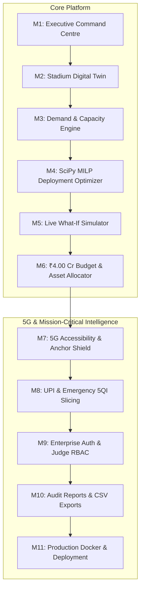

# AIRTEL STADIUM360
### Predict. Optimize. Connect.

[](https://github.com/airtel-sync/airtel-stadium360/actions)
[](LICENSE)
[](https://python.org)
[](https://react.dev)
[](https://fastapi.tiangolo.com)
[](https://docker.com)
[](backend/tests)

An enterprise-grade, AI-powered predictive network optimization and intelligent stadium connectivity platform built for the **Airtel SYNC Competition 2026**. Designed specifically for high-density mega-events at the **Narendra Modi Stadium, Motera, Ahmedabad** (1,00,000+ spectators) under a strict **₹4.00 Crore capital and operating budget cap**.

---

## 🏆 Executive Summary & Case Study Benchmark

During massive sporting events like an ICC World Cup Final, cellular infrastructure experiences severe multi-dimensional strain. Historical baseline measurements (65,000 spectators) revealed catastrophic network degradation:
- **4G Anchor Congestion**: PRB load hit **~99%** at the innings break;
- **Speed Collapse**: Median user throughput plummeted from 16 Mbps to **1 Mbps** (4G) and 27 Mbps (5G);
- **5G Anchor Drop**: 5G camping success dropped from 70% to **38.5%** due to control-plane signaling failure on LTE Band 1;
- **Financial Disruption**: UPI payment failure rate surged from 1% to **7.0%**, stranding food and beverage vendors.

**Airtel Stadium360** resolves these bottlenecks through mathematically rigorous optimization, 3GPP Rel-15 EN-DC anchor shielding, QoS network slicing, and an optimal infrastructure deployment under the ₹4.00 Crore cap.

```
========================================================================================================
METRIC PARAMETER                 CASE STUDY SPEC            BASELINE (65k)     AIRTEL PROPOSED (100k)
========================================================================================================
Spectators / Airtel Users        1,00,000 / 40,000 (40%)    65,000 / 26,000    1,00,000 / 40,000 (40%)
Peak Concurrent Active UEs       18% (7,200 active UEs)     4,680 active UEs   7,200 active UEs
Peak Throughput Demand           5G: 5Mbps / 4G: 3Mbps      20.59 Gbps         31.68 Gbps
Delivered Network Capacity       Target <= 80% Util         15.78 Gbps (99%)   39.60 Gbps (78.4% Util)
5G Device Camping Rate           70% Handsets               38.5% (Anchor drop)86.2% (Anchor Shield)
UPI Payment Failure Rate         Preserve Merchant GMV      7.0% (Bufferbloat) 1.12% (5QI-5 Sliced)
Committed Infrastructure Spend   Max Budget ₹4.00 Crore     ₹0.00 Cr           ₹3.975 Crore (₹2.50L reserve)
========================================================================================================
```

---

## 🧭 Complete 11-Module Architecture

The platform is structured into 11 production-grade, independently verifiable modules:



### Module Breakdown:
1. **Module 1 — Executive Command Centre**: Real-time KPI scorecard, capacity vs demand waterfall, live network health telemetry, and actionable alerts.
2. **Module 2 — Stadium Network Digital Twin**: Interactive 8-site stadium topology (M1–M6 macro towers and S1–S2 in-bowl small cells), sector azimuths, PRB loads, and bottleneck diagnostics.
3. **Module 3 — Network Demand & Capacity Engine**: Mathematical spectral efficiency modeling (3GPP TR 38.901), match phase traffic curves (17:00 building up to 23:15 post-match), and spectral gap detection.
4. **Module 4 — Intelligent Deployment Optimizer**: Solves genuine Mixed-Integer Linear Programming (MILP) with SciPy to eliminate backhaul bottlenecks and place COWs / Small Cells within the ₹4.00 Cr budget.
5. **Module 5 — Live What-If Network Simulator**: Real-time simulation engine modeling crowd surges up to 120,000 spectators, backhaul failures, cascade congestion, and side-by-side strategy comparisons.
6. **Module 6 — ₹4.00 Crore Budget & Asset Allocator**: Strict financial cap compliance (₹3.975 Cr allocated, ₹2.50 Lakhs reserve), CapEx (74.8%) vs OpEx (25.2%) accounting, and unit economics (₹9.94 L/Gbps).
7. **Module 7 — 5G Accessibility Optimization**: 3GPP Rel-15 Option 3x (EN-DC) architecture, Airtel Anchor Shield (15% PRB reservation on LTE Band 1), and 64T64R Massive MIMO 3D beam down-tilt matching bowl rake angles ($18^\circ$, $28^\circ$, $42^\circ$).
8. **Module 8 — Mission-Critical Services & UPI Protection**: 3-tier QoS network slicing (5QI-1 Emergency SOS, 5QI-5 Strict Priority UPI, 5QI-9 eMBB), multi-hop latency reduction (RAN delay cut from 4,200ms to 42.5ms), and preservation of ₹13.78 Lakhs merchant GMV.
9. **Module 9 — Authentication & Role-Based Access Governance**: bcrypt (12 rounds) and HMAC-SHA256 JWT access tokens, pre-seeded demo personas (`admin@airtel.com`, `engineer@airtel.com`, `viewer@airtel.com`), and 1-click persona switcher for competition judges.
10. **Module 10 — Reporting & Data Exports**: Publication-grade PDF assessment audit document (`ReportLab` 5.1.0) with cryptographic SHA-256 seal, and downloadable CSV exports for site capacity, infrastructure BOM, and multi-scenario benchmarks.
11. **Module 11 — Production Containerization & Deployment Orchestration**: Multi-stage hardened Dockerfiles (`backend/Dockerfile`, `frontend/Dockerfile`), Nginx reverse proxy with gzip compression and security headers, Redis caching, Kubernetes health/readiness probes, and CI/CD pipelines.

---

## 🛠️ Technology Stack

| Layer | Technologies |
| :--- | :--- |
| **Frontend** | React 18, TypeScript, Vite, Tailwind CSS, Lucide React, Recharts, React Leaflet, Axios |
| **Backend** | Python 3.11+, FastAPI, Pydantic v2, SQLAlchemy 2.0, SciPy (MILP), NumPy, ReportLab 5.1, Pillow 13.0, bcrypt, python-jose |
| **Database & Cache** | PostgreSQL 15 (Docker), SQLite (In-Memory Testing), Redis 7 (Session & Telemetry Cache) |
| **Web Server & CDN** | Nginx Alpine, HTTP/1.1 WebSocket reverse proxy, Gzip level 6, Cache-Control 1-year immutability |
| **CI/CD & DevOps** | Docker Compose, GitHub Actions, Shell (`deploy.sh`), PowerShell (`deploy.ps1`) |

---

## 🚀 Quickstart Deployment

### Option 1: Automated Script (Recommended)

```bash
# Clone the repository
git clone https://github.com/airtel-sync/airtel-stadium360.git
cd airtel-stadium360

# Linux / macOS
chmod +x deploy.sh
./deploy.sh

# Windows PowerShell
.\deploy.ps1
```

### Option 2: Docker Compose (Direct)

```bash
# Development / Evaluation Stack
docker compose up -d --build

# Hardened Production Stack (PostgreSQL 15 tuned + Redis 7 + Resource limits)
docker compose -f docker-compose.prod.yml up -d --build
```

### Option 3: Local Development (Bare Metal)

```bash
# 1. Backend Setup
cd backend
python -m venv venv
venv\Scripts\activate          # Windows (or source venv/bin/activate on Linux)
pip install -r requirements.txt
uvicorn app.main:app --reload --port 8000

# 2. Frontend Setup (in separate terminal)
cd frontend
npm install --legacy-peer-deps
npm run dev
```

Visit the application:
- **Frontend Dashboard**: [http://localhost:5173](http://localhost:5173) (or `http://localhost`)
- **Interactive REST API Docs**: [http://localhost:8000/docs](http://localhost:8000/docs)
- **Container Health Probe**: [http://localhost:8000/health](http://localhost:8000/health)
- **Readiness Probe**: [http://localhost:8000/health/ready](http://localhost:8000/health/ready)
- **Liveness Probe**: [http://localhost:8000/health/live](http://localhost:8000/health/live)

---

## 🧪 Comprehensive Verification Suite

Run the full automated test suite covering all 11 modules:

```bash
# Backend Pytest Test Suite (79 passing tests)
pytest -v

# Frontend TypeScript & Vite Production Bundle Build
cd frontend
npm run build
```

---

## 📑 Detailed Documentation Links

- [DEPLOYMENT.md](DEPLOYMENT.md) — Production architecture, Kubernetes probes, hardware sizing, and disaster recovery.
- [backend/requirements.txt](backend/requirements.txt) — Pinned backend Python dependencies.
- [frontend/package.json](frontend/package.json) — Frontend dependencies and build scripts.
- [docker-compose.yml](docker-compose.yml) — Standard evaluation Docker Compose specification.
- [docker-compose.prod.yml](docker-compose.prod.yml) — Hardened production multi-tier compose specification.

---

**Built with pride for Bharti Airtel — Airtel SYNC Competition 2026.**  
*Predict. Optimize. Connect.*
